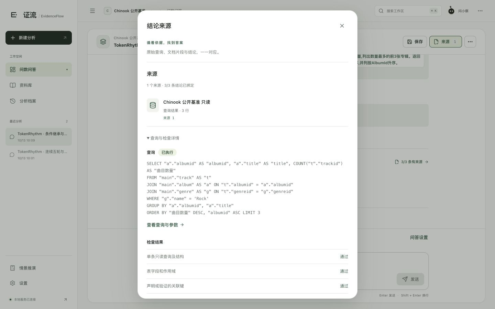
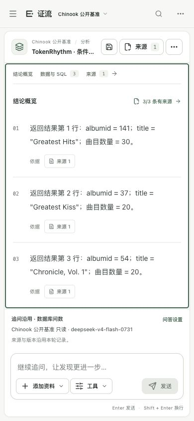

# TokenRhythm 真实问答与优化验收 · 2026-10-13

当前已完成队友代码合并、前端构建与服务更新、TokenRhythm / DeepSeek 实际接入、分批真实问答诊断、通用能力修复、三档组件性能及页面验收。用户最新要求为直接同步 GitHub，覆盖旧文件并保留提交历史，不制作 RAR。Windows 实机和真人逐题语义复核按用户决定保留待办。

本报告不授予比赛分数，不以自动匹配、模型 `supported` 或引用定位率冒充独立业务准确率。题集由同一开发方编写，参考 SQL 在只读原库独立执行，参考答案不进入模型输入；首次失败、题面勘误、完整回归和针对回归分别保存。

## 当前版本及实际接入

- 队友截至 `1bd9fa359f035a7fcf22aee3a9440ab20856785b` 的更新已合并，保留 Chinook、中文结论、目录/质量/复杂度等新增功能。
- 作者本机主文本：`https://tokenrhythm.studio/v1`，账号列表与实际响应标识 `deepseek-v4-flash-0731`；单请求90秒。此为提供方的型号标识，不据此验证底层模型权重。
- 独立视觉：账号可用 `deepseek-flash`。实际颜色探针和公共扫描图页解析完成；主文本模型未被当作支持图片。
- 密钥在本机加密连接存储中，临时明文文件已清除；公开接口和 GitHub 副本不含密钥。
- 本轮没有比较费用。原 TokenDance / Qwen 连接禁用保留历史，失败后不自动切换。

文本、JSON规划、原生工具调用与SSE探针见 [实际协议探针](验收证据/TokenRhythm结构化工具与流式探针-20261012.json)，视觉见 [实际视觉探针](验收证据/TokenRhythm视觉通道实际探针-20261013.json)。SSE探针实际收到2个内容分块与DONE，不能据此称长期不断线或完整答案逐字流式验收全部通过。

## 真实资料与样本范围

公开统计项目有11个文件，约7组出版来源。三地官方统计PDF共36页；人形机器人征求意见稿、起草说明为机构原生Word，并有官方公告正文；生态环境完整扫描原件150页和4页摘录为同一来源；全国碳市场报告为33页原生PDF；openEuler白皮书为91页原生PDF；统计Word为忠实转换展示件。

原始下载字节、文件摘要、官方入口、来源组、派生关系、草案状态及软件版本保留。`24.03` 是软件版本，不是白皮书发布日期；未核验的发布日期保持未知。没有用AI短文冒充公开原件或新增独立来源。统计库仍是39个指标、73条已登记观测；不能由资料文件增多推断数据库取值已自动丰富。

Chinook使用上游MIT许可SQLite原件，11表15,607行。58表困难任务为公开合成模式、含54张干扰表，不是陌生企业实库。

## 完整批次与针对回归

| 批次 | 自动诊断结果 | 保留的限制与依据 |
|---|---|---|
| 原Chinook 20题首测 | 严格SQL行列15/20，技术失败1，P50 6.55秒 | [原首测](验收证据/ChinookTokenRhythm首测-20261012.json)；未指定顺序和员工管理关系等参考争议保持原记录 |
| 题面明确的复杂Chinook新20题首测 | 严格SQL行列19/20（95%），技术失败1，P50 6.54秒 | [新题首测](验收证据/Chinook题面明确复杂新题首测-20261013.json)；唯一失败为不存在字段，通用反馈修复后[针对1/1](验收证据/Chinook缺失字段自动修复回归-20261013.json)，不合并称20/20 |
| 真实原生Word/PDF 14题首测 | 必要项13/14，原件定位14/14，技术失败1 | [首测](验收证据/真实Word与PDFTokenRhythm基线首测-20261012.json)；公报发布时间被当测量值误拒，修复后[针对1/1](验收证据/公报年份语境修复回归-20261013.json) |
| 多文档原题10题首测 | 必要项3/10，技术失败6 | [失败首测](验收证据/多文档真实原件TokenRhythm首测-20261013.json)；实际出现上游429，不删除失败 |
| 原题引用与节奏修复完整回归 | 必要项5/10，来源定位10/10，技术失败1 | [原题回归](验收证据/多文档原句引用与节奏修复回归-20261013.json)；部分参考额外要求了未问细项，不能直接据此改原题成绩 |
| 多文档指定章节10题完整回归 | 必要项9/10（90%），技术失败1 | [完整批次](验收证据/多文档指定章节完整回归-20261013.json)；新题面明确发明专利与白皮书章节，原题/参考/失败保留；最后跨页题经通用修复后[针对1/1](验收证据/多文档跨页最终针对回归-20261013.json)，仍不称完整10/10 |
| 六种明确输出的跨源首测 | 必要项3/6、严格SQL5/6、实际答案原件定位4/6，技术失败1 | [首测](验收证据/明确输出合同跨源TokenRhythm首测-20261013.json)；包括特殊字符别名语法失败、参考页码问题及覆盖判断误拒 |
| 六种跨源v2完整回归 | 必要项6/6、严格SQL6/6、实际答案原件定位6/6，技术失败0 | [当前完整回归](验收证据/明确输出合同跨源TokenRhythm完整回归-20261013.json)；v2仅允许淮南人口第2页正文及第3页表格，题面/SQL/数值未改；P50 34.98秒，最大39.57秒，46次模型调用，最终引用15处 |
| 58表6案例、7轮回归 | 严格SQL6/6、状态7/7，技术失败0 | [困难任务](验收证据/58表困难任务TokenRhythm回归-20261013.json)；跨期、同名、等额记录、空对象及澄清均有独立SQL |
| 连续五轮 | 原首测2/5；筛选继承修复完整回归5/5 | [当前五轮](验收证据/TokenRhythm连续五轮条件继承回归-20261013.json)；不能用每轮最好的不同批次拼成绩 |

六种跨源覆盖：比例与公布值、三地人口原件、当年价与实际增速、分项加总差异、统计排序结合政策部门、PM2.5跨地排序与原文。只检查最终答案实际使用的引用，召回过但未被答案引用的材料不算回答来源。

## 修复的通用能力

模型继续负责意图理解、表结构选择、SQL规划、文档检索及答案组织，程序负责核验数据、单位、年份、对象与引用。修复不按题号提供固定答案。

1. 中文“前五位”等排名不再被当作时期，明确行/列数量在执行前检查。不存在的字段返回真实可用字段和外键；含百分号、点号等别名提示加引号。
2. 多表关联仍需真实外键/已核验关系。统计同表跨年自关联仅接受数据库实际完整唯一键和每个别名无歧义固定条件，保留拒绝扇出与错误粒度的保护。
3. 数据库自然解释使用实际SQL的计数、聚合、时期及单位合同；计数不能因别名变为百分比，未知净额/原因不能自动成立。实际SQL及模型支持检查案例见 [数据库解释](验收证据/DeepSeek数据库解释与模型核验实际案例-20261013.json)。
4. 连续追问明确保留同一流派等条件，从上一轮经校验SQL继承无歧义的物理列等值筛选并在执行前核对。明确更换/取消条件时停止继承，不能由模型遗漏筛选后仍标成功。
5. 原生PDF跨页候选保留同版本两页完整原句、文字范围及摘要；原页脚和派生表格不打乱阅读顺序。候选仅提示阅读，不自动证明事实。
6. 引文缩窄保持固定偏移。证据支持评审与回答目标覆盖分开；未知/遗漏/矛盾ID拒绝，通过有界协议修复返回实际已审结论。原件核验不能由独立数据库行代替。
7. 来源已登记的出版年份、PM2.5/MPEG-4等实际名称不误判为新测量数值；新数字、增长方向与单位仍须核对。空SQL事实进入明确资料不足分支，不把0行写成数值0。
8. 答案修复重整重复控制消息与已有证据，减少过长上下文；固定问题、完整原件片段和实际查询不靠截断或重查规避。

相对合并后的本机基线，本轮Python源码/测试/评测脚本共48个变化文件，其中21个新增，新增2442行、删除74行；不包含队友合并本身、公开原件、文档与构建。逐文件统计见 [实际改动统计](验收证据/TokenRhythm本轮源码改动统计-20261013.json)。

## 稳定性、取消与恢复

TokenRhythm同一密钥请求启动间隔至少2秒；等待可取消，受整轮600秒约束。普通范围12次模型/8次工具/3次SQL，跨源16/10/5，文档搜索最多2次。成功收到但协议结构无效时允许一次新的有界修复操作；已发送POST的网络超时、429和读取中断不自动重放。

真实五轮后，模型规划实际完成再发起取消：约224.21ms进入cancelled，晚到结果未发布，旧成功结果保留。同一请求ID返回同一任务；实际停启当前目录服务后实例改变、目录身份一致，五轮结果、选择及取消记录均恢复；明确重试产生新任务并保留attempt_of，结果匹配。该案例不能证明提供方服务器已经停止推理或不再计费。

曾出现429；随后单次实际请求返回200，见 [恢复探针](验收证据/TokenRhythm429原因实际核验-20261013.json)。因原始失败未提供足够代码/追踪信息，不能确定每次429的原因，也不能保证永久不掉线。启动健康等待提升至180秒以覆盖大PDF首次解析，仍检查自有目录实例及进程存活，不关闭其他服务。

## 扫描、公式与质量边界

生态环境150页原件仅实测第7/47页本机OCR（4.30秒），第47页公共图表视觉解析（21.16秒），原件字节保持不变，见 [真实扫描任务](验收证据/真实扫描页OCR与视觉解析-20261013.json)。图表未标注柱值的精确数值仍需复核，未声明150页全文识别完成。

原生Word/数学结构、目录推定、复杂度与页面倾斜/旋转/清晰度告警已实现，告警不自动改原文。此前OHR/JATS与退化小样本仅支持结构和质量诊断；扫描公式的完整分母/上下限、低清标签、多级/跨页表格的独立准确率仍待完成，不能据同引擎一致或结构存在宣称中级公式任务全部攻克。

## 多规模性能与复杂度

当前机器Apple M4、10逻辑核、16GiB，macOS 26.6.2 arm64，Python3.13.6。以下为隔离合成数据的组件实测，每档3次重复；另有2并发小样本，操作系统缓存未清空，未排除其他系统负载。0次付费文本模型调用，不含浏览器、远程生成或Windows，见 [完整性能](验收证据/最终源码离线多规模性能-20261013.json)。

| 规模 | 暖机P50 | 首次/预处理 |
|---|---|---|
| SQLite 1千行 | 3.11ms | 查询40.58ms |
| SQLite 1万行 | 5.52ms | 查询5.94ms |
| SQLite 10万行 | 35.74ms | 查询36.88ms |
| 原生PDF 10页 | 检索568.57ms | 解析96.83ms，索引935.51ms |
| 原生PDF 100页 | 检索779.73ms | 解析920.25ms，索引6939.24ms |
| 原生PDF 500页 | 检索1533.63ms | 解析5943.99ms，索引34527.48ms |

三档SQL均与独立结果匹配、库文件摘要不变；三档PDF各24/24引用可定位，检索无错误；9个取消点全部响应。3次样本的P95仅描述此次观测，不作为生产容量结论。当前真实复杂Chinook端到端P50约6.54秒、跨源约34.98秒，与本机毫秒级SQL是不同测量范围。

结构读取随表T、列C和关系R增长，元数据遍历约O(T+C+R)，候选排序另有O(TlogT)；SQL验证成本与AST大小、作用域、列和关系有关，并受语句/步骤上限约束。执行复杂度取决于真实计划：索引过滤通常为O(logN+M)，全扫描O(N)，排序O(MlogM)，关联须另外考虑索引和中间结果；不能把所有SQL都称O(N)。

设切片N、向量维度d、候选k、文档词数L。本机文本加载/词项统计随L增长，BM25候选和排序随N增长；当前向量相似度遍历约O(Nd)，向量存储O(Nd)，文本存储O(L)。融合/候选排序有O(NlogN)或有界候选部分的O(klogk)成本；重排仅处理最多约30候选，但神经网络耗时依赖实际文本长度和模型。索引建立需要逐批嵌入，首次成本不能算入每次暖机检索。远程规划/生成则取决于上下文、输出长度、调用轮数与上游时延，不由数据库行数单独决定。

任务管理路径配置4工作线程、总在途/排队12；仅实测2个组件并发，没有最大模型并发压测。按本次跨源46/6≈7.67次调用/题与单密钥至少2秒启动间隔，理想调用额度上界约3.9题/分钟；这是忽略上游耗时和限流等因素的估计上界，不是已实现吞吐量。当前瓶颈主要为远程多轮证据检查和本机重排，已采用索引复用、候选边界、结构按需读取、相同查询快照复用、上下文重整与有界调用；后续提速须同时核对检索质量和答案正确性。

## 评分对应及仍缺的证据

依据随项目保存的[官方赛题](../05_比赛与交接/官方资料/8%20赛题八：网信产业应用赛道-多模态数据驱动的可解释精准问数问答智能体（中电云计算技术有限公司）.pdf)第5–6、10–13页：初赛需至少1个中级任务，决赛需至少3个；复杂SQL与多文档/多模态最高准确率档为90%；决赛要求三种规模、复杂度、吞吐量估计及优化策略。文件要求是评分依据，不是自动发布或提交授权。

| 评分方向 | 现在可展示 | 尚缺 |
|---|---|---|
| 基础单表、单文档 | 既有10题单表、当前Chinook与14题原生Word/PDF；参考SQL/原文与实际答案 | 独立人员正式复核，不能以本轮混合复杂题替代基础10题的完整计分 |
| 中级③语义校验澄清 | 缺时期/口径等澄清，连续追問与同库筛选保留 | 新业务模糊题独立评测 |
| 中级④精准表定位、⑤多表NL2SQL | 58表干扰、多跳JOIN/聚合/嵌套/CTE、粒度与唯一键保护 | 陌生企业库、独立题集与真人核验 |
| 中级⑦目录、⑧复杂度、⑨质量 | 原PDF目录推定、块标题路径、可解释复杂度和页面质量告警 | 更广真实层级、独立难度/清晰度标注、任意错别字与校正效果；不是三项全部完成的证明 |
| 中级⑥公式 | 原生数学结构、受限计算与参数缺口检查 | 复杂扫描公式识别和参数绑定端到端准确率 |
| 跨源与可解释性 | 六类完整跨源、SQL/工具/文档原件证据链、官方出处 | 新多跳领域案例与独立忠实度 |
| 连续五轮 | 真实5/5及实际取消、重启恢复、明确重试 | 更长/跨主题独立对话 |
| 效率与伸缩性 | 三档组件数据、端到端批次、复杂度与理想吞吐估计 | 长期负载、稳定最大并发、不同配置与Windows实机 |
| 演示和文档 | 桌面/390px窄屏、模型与真实SQL来源，完整工程说明 | 官方Word/PDF技术文档、匿名PPT、正式技术数据ZIP和现场答辩 |

新增复杂题95%、多文档必要项90%仅达到开发诊断目标；尚不能据此声称官方评分达标或一等奖就绪。联网搜索仍排在核心正确性之后，本轮只提供已核验的官方出处跳转。

## 工程、界面与GitHub同步

后端38模块616项全部通过，见 [隔离日志](验收证据/TokenRhythm最终离线后端回归-20261013.log)。前端68项、类型与正式构建通过，53个前端源码文件与本轮验证副本逐字一致，11个服务部署文件摘要匹配；服务启动时冻结的36个后端摘要与当前磁盘一致。11个原件下载摘要一致，见 [运行核对](验收证据/最终源码与运行服务一致性-20261013.json)。

桌面1440×900、窄屏390×844实际阅读完成，窄屏页面宽度390、无整页横向溢出。真实DeepSeek多轮答案、SQL只读检查及来源入口可查看；官方Word草案及发布时间、官方来源入口已有截图。此为本机页面验收，不能作为Windows实机或真人事实核验。

按用户最新指令，直接同步当前源码、正式构建、公开原件及验收证据到GitHub并保留历史，不生成RAR。具体范围和隐私排除见 [源码快照说明](../05_比赛与交接/GitHub源码快照说明-20261013.md)，上传是否完成以远程提交与发布核验记录为准。作者本机新服务保持运行。
