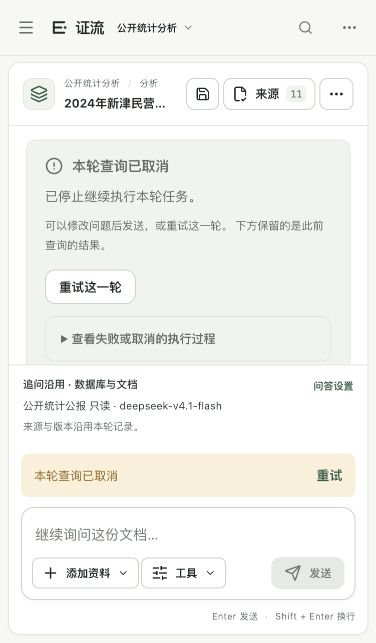
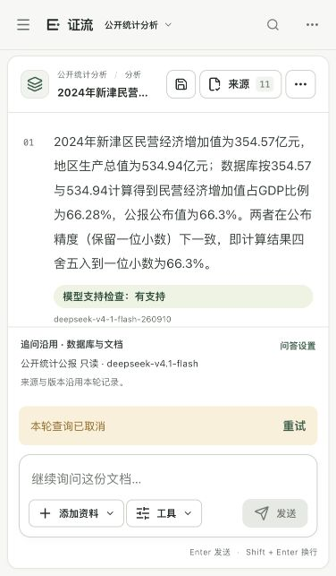

# 会话恢复与取消核验 · 2026-10-11

本批完成前端状态读取的时间边界、重连间隔和已接受任务保留，并在当前本机DeepSeek连接上实测取消与刷新。后端、模型配置和冻结问答题集未改；没有费用测试、重新打包或GitHub推送。

## 修改内容

修改2个源码文件，新增1个测试文件：`frontend/src/ui.tsx`、`frontend/src/conversations.tsx`、`frontend/tests/session-recovery-ui.test.tsx`。正式构建已替换本机运行的`frontend/dist`，构建缓存和上一版备份留在工作区外。

- 会话和项目状态读取默认最多等待12秒；时间边界包含响应正文读取。任务提交、手动重试和取消的响应等待最多20秒，这不是模型执行总时长。
- 状态读取失败后的重连等待为1、2、4、8秒，最多8秒；读取成功后回到700毫秒正常轮询。页面说明正在恢复已有查询，不会再次发送问题。
- 任务提交已被服务端接受时，先保留真实任务ID，再读取完整会话。后续GET失败不会丢掉该任务或此前答案。
- 切换会话会停止旧会话的状态读取，不把取消读取误报为模型连接故障；它不取消服务端的查询。
- 保留原有请求ID与手动恢复入口；超时后不自动重放已发送的POST。服务端取消与最终失败说明继续使用实际任务状态。

## 工程验证

前端59/59项通过，TypeScript检查和正式构建通过。新增6项覆盖请求停滞、正文读取停滞、外部取消读取、成功及服务端错误、重连间隔边界、已接受任务与旧答案保留。构建仍提示现有图表模块压缩前超过500kB，未影响构建完成。

本批后端未改，复用上一批27模块449项通过的证据；不把这449项解释为449道比赛问答正确。部署后每个正式文件SHA-256与本次构建匹配，服务健康检查通过。

证据：[前端回归](验收证据/会话恢复前端最终回归-20261011.log)、[类型检查](验收证据/会话恢复前端最终类型检查-20261011.log)、[构建](验收证据/会话恢复前端构建-20261011.log)、[部署摘要](验收证据/会话恢复部署核验-20261011.json)、[源码与核验摘要](验收证据/会话恢复源码核验-20261011.json)。首次类型检查的3处空值缩窄错误已修，失败日志保留，不计为最终通过。

## 浏览器实测

使用现有公开统计演示会话，保留新津民营经济比例的旧答案，提交一次“三份2024公报PM2.5排序、差值及跨页原句核对”问题。页面进入真实执行状态，显示取消按钮；在任务执行期间点击取消。

服务端新增任务`bf947a82-cb27-475b-a61f-2b5174e2d8d8`最终为`cancelled`，请求ID`81aae1f1-fb60-4d19-99d1-5ed090edc7e9`。提供方在本次任务中返回的模型名称为`deepseek-v4-1-flash-260910`；不据此独立证明上游模型身份。

页面显示“本轮查询已取消”和手动重试入口，并说明下方保留此前结果。旧答案的354.57亿元、534.94亿元、66.28%与公报66.3%及来源仍可阅读。刷新后取消状态、旧答案、原选中消息和手动重试入口均恢复。部署前该会话1个任务，刷新及再次读取后2个任务，仅新增这1个取消任务，没有重复提交。未点击重试。

证据：[任务前后核验](验收证据/DeepSeek取消与刷新任务核验-20261011.json)、[取消页面状态](验收证据/DeepSeek取消页面状态-20261011.txt)、[刷新页面状态](验收证据/DeepSeek刷新页面状态-20261011.txt)。

## 尚未证明的事项

状态读取停滞与退避使用协议模拟测试覆盖；本轮浏览器实测当前连接的取消与刷新，不冒充真实长期断网或连续负载验证。本地停止继续执行不证明已发送的上游HTTP请求即时终止，上游传输仍受既有时间边界控制。

完整公开20问的严格输出布局、独立真人语义复核、陌生企业数据库和Windows实机仍需补证据。用户明确暂缓的真人复核及Windows保持待办，不能以本批工程测试宣称一等奖就绪或永久不断线。
