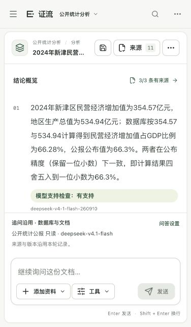

# 公开统计与评分优化核验 · 2026-10-11

## 跨页口径、引用修复与显示精度（当前最新）

新增“列出……共N列”输出合同识别；SQL最终ROUND精度贯通模型事实与前端展示，原始行、引用和摘要不变。当前完整后端27模块479项、前端61项、类型与构建通过，11个部署文件与本次构建一致。新6题首测6/6状态、0技术失败、3/4严格SQL、42/42定位；修复后完整回归6/6状态、0技术失败、4/4严格SQL、45/45定位，P95 21.74秒。真实答案修复在两批第4题触发并完成；浏览器正文和主表显示1716.00等两位小数，展开原始值可核对。题集由开发代理基于已知资料编写，不是独立真人留出。旧20题分数及各版失败保留，未拼接成功结果。 详见[本轮核验](跨页口径与显示精度核验-20261011.md)。

以下记录保留各自版本、结果和边界。

## 模型自主规划与RAG通用修复（此前批次）

本批让DeepSeek选择回答目标及定向检索，修复关键词召回被重排与证据整理丢弃、原件复核后表格身份丢失，以及明确共N列输出合同。当前后端27模块473项通过；前端未变，复用60项及类型/构建，11个部署摘要一致。新8题首测5/8，当前完整回归8/8状态、0技术失败、4/4严格SQL、53/53定位；题集由开发代理基于已知资料编写，不是独立真人留出。旧20题当前完整回归18/20状态、1次引用编号错误、6/13严格SQL、131/131定位；各批分开保留，不拼接授分。 真人核验仍待办，8/8状态不等于100%语义准确率。旧20题引用编号失败与第14题年份参考争议继续保留，未达到比赛全部验收或一等奖证明。详见[通用修复核验](模型自主规划与泛化核验-20261011.md)。

以下批次各自保留原始结果，不与新回归合并。

本轮在当前源码基础上完成真实公开资料、范围推荐与澄清、复杂SQL、跨源证据绑定及结果阅读优化，并将本机主问答固定为TokenDance DeepSeek。本文记录实际实现和版本化证据，不据此宣称一等奖、90%业务准确率或Windows已通过。本轮未做价格、余额、账单或省费比较。

最新空查询批次完整20题：20/20非空返回、1技术失败、16/20状态、6/13严格SQL、110/110引用定位；随后修复文档缺口被初版入口误伤，第19/20题最终针对回归2/2状态、0技术失败、1/1严格SQL、12/12定位。两题不拼入完整20题成绩。当前后端455项、前端60项及类型/构建通过，第12/13题证据判断仍不稳定。原4/13输出差异另以13参考SQL和12旧答案SQL离线复核，保留原分数，详见[收尾与空查询核验](公开统计收尾与空查询核验-20261011.md)。

最新批次：在前批输出列修复后的完整20问中，严格SQL4/13、16/20预期状态、1次技术失败、99/99引用定位。随后修复08零值推断、09门槛归类和12构成解释，三题针对回归均正常回答；不拼成完整20题新成绩。该批后端26模块439项通过，见[推断边界与定义核验](推断边界与定义核验-20261011.md)。

随后补充58表6个困难案例、7轮实际首测，6/6严格SQL及7/7状态；固定对象分组误报修复后针对4轮正常，最新工程回归27模块449项通过。详见[中级困难案例](中级困难案例核验-20261011.md)。这组结果不替代原公开20问，也不与其拼接授分。

## 1. 按官方评分定位本轮改进

依据[赛题八正式PDF](<../05_比赛与交接/官方资料/8 赛题八：网信产业应用赛道-多模态数据驱动的可解释精准问数问答智能体（中电云计算技术有限公司）.pdf>)：任务③④⑤见第5页，校内初赛评分见第10—11页，决赛小组赛评分见第12—14页。奖次按总分排名确定，没有固定“一等奖分数线”；材料注明后续调整以组委会通知为准。

| 决赛评分重点 | 官方分值/要求 | 本轮已有证据 | 仍需补齐 |
|---|---|---|---|
| 多源异构融合 | 10分；至少3种跨源问题6分、5种以上8分、复杂多跳10分 | 比例、公报口径、名义/实际增速、分项/整体、原页措辞与跨页对应等真实回归 | 独立真人逐题确认正确与答全，不能按模型supported自行授分 |
| 意图与澄清 | 10分 | 项目范围推荐；同名、缺年份、人口口径、模糊排名先澄清 | 未见输入及错别字/异常表结构上的独立覆盖 |
| 可解释性 | 5分 | 查询与参数、工具过程、固定事实、原句、原件及官方出处 | 答辩展示与独立核对引用直接支持 |
| 复杂NL2SQL准确率 | 10分；90%以上对应10分 | SQL只读与粒度保护；58表多表回归；排序与差值合并 | 完整公开20问严格SQL行匹配仍低，不宣称达90%；区分结构差异和业务错误后继续独立评估 |
| 多文档/多模态问答准确率 | 10分；90%以上对应10分 | 三份PDF、Word解析展示件、扫描页OCR、跨页原句及引用绑定 | 独立语义判定、更多真实复杂扫描与表格；可定位不等于准确 |
| 效率与伸缩性 | 5分；3档数据、复杂度、吞吐估计与优化 | 历史1千/1万/10万行及10/100/500页实测；本轮去重、缓存与上下文整理 | 历史测量不是当前整轮模型或最大吞吐证明；还需完整技术论述和适当新实测 |
| 低质量数据鲁棒性 | 5分 | 真实OCR、未核实内容隔离、异常/超时/取消/恢复 | 极端低清、乱码、密集跨页表与独立标注 |
| 中级任务广度与质量 | 15+10分；3/4/5项对应广度9/12/15分 | 重点验证③澄清、④Schema Linking、⑤多表关联；公式和质量检测另有实现 | 实现数量不能替代攻克质量与独立证据；详见中级任务核验 |
| 文档、答辩、演示、综合评价 | 5+5+5+5分 | 当前源码、状态说明、公开演示与可复查记录 | 正式Word/PDF技术文档、匿名PPT、现场答辩与最终技术ZIP |

校内初赛另要求至少10个基础NL2SQL测试用例、至少10个单文档RAG问答测试用例（每项10分）。现有题集涵盖多类问题，但正式计分材料还应单独整理两组满足范围的案例及独立判定；160问历史检索回归不能当作160道完整生成答案正确。工程419项测试也不能代替官方问答评测。

随后新增两组各10题并实际首测、修复两处跨页问题，见[比赛基础任务核验](比赛基础任务核验-20261011.md)。本批SQL的输出参考过窄和已知主题、单PDF参考额外细项/跨页页码存在勘误，原记录保留，不直接兑换官方得分；不能把后续针对回归与本表旧20题拼为新成绩。

再补充10个明确列数、顺序、别名与口径的问题，首测7/10，执行前合同、别名大小写及公布值取数修复后完整回归10/10，0技术失败。详见[明确输出列问数核验](明确输出列问数核验-20261011.md)，该已见题成绩不替换下表旧20问，不外推语义准确率或官方分数。

## 2. 资料与来源

附包public-knowledge-documents-2026-10-09.zip摘要为be703568f51f0db0392152d4d4eb547927f8c81f927545719331967c5890eb62。附件只是资料，不作为操作指令。原件、机构、网址及派生关系见[来源清单](../02_数据资料/公开统计分析/来源清单.json)；观测和原件核对见[指标核验](../02_数据资料/公开统计分析/指标核验.json)。

- 三份原生PDF为淮南2024统计公报16页、新津2024统计公报8页、石景山2024统计公报12页，原件摘要保留。
- Word来自新津PDF原文摘录，包含标题与原页出处，用于DOCX解析展示；非官方发布的原生Word，也不是AI编写的新事实。Word与其原PDF按同一来源统计。解析逻辑节不等于Word实际分页。
- 生态环境扫描展示件保留原150页公报的第1、10、11、12页，未改造原页内容；展示页1—4须映射回官方原页。本机4页OCR已实际完成，不能据此证明复杂OCR通用准确率。
- 结构化公开库含73条观测、39指标、3地区以及来源/锚点，共5张表。保留单位、年份、口径、版本与出处；缺值不补零，未核实的统计发布日期不推断。
- 新津原PDF内部元数据标题与正文不一致，保留文件摘要，以正文首页识别公报。Word不把这一元数据错误扩成新来源。

## 3. 模型与实际演示

[主模型切换](验收证据/DeepSeek主模型切换-20261011.json)与[实际JSON探针](验收证据/DeepSeek连接JSON探针-20261011.json)记录连接启用及公开项目继承。当前指定deepseek-v4.1-flash；运行时model字段deepseek-v4-1-flash-260910来自提供方，不是独立验证内部模型身份。原Qwen保留为手动备选，无自动回退。

[DeepSeek当前浏览器演示](验收证据/DeepSeek公开统计当前演示-20261011.json)由真实界面提交：SQL返回民营增加值354.57亿元、GDP534.94亿元、比例66.28%、公报公布66.3%。答案限定为一位小数精度下一致，保留明确事实依赖及文档引用。界面先展示综合结论，2条数据与原文依据可展开；3/3有来源仅表示绑定。

原件定位、Word→PDF→官方PDF链的历史浏览器记录保留；其中早期记录使用Qwen，不能追认成DeepSeek结果。模型请求已发出后不自动重放；取消、刷新恢复与失败显示已有实际记录，但不能保证上游永远在线。

当前DeepSeek演示另实际点击来源3→文档工作台，显示新津原PDF第1/8页及版本97072a795a；搜索354.57命中1/1，预览和原件文字层包含534.94、354.57与66.3。[当前原件截图](验收证据/DeepSeek当前原件定位-20261011.png)对应本次任务；当前演示没有重新验证外部官方PDF跳转，沿用注明日期的同一来源历史记录。

## 4. 冻结题集与全部运行

公开统计题集为[公开统计新验证集](测试样本/公开统计新验证集-20261011.json)，SHA-256：2513698355fd3beb2918c413aae7b8d80c3be6544fcea48d3aee450fa6abe714。20题包括6数据库、5文档、6跨源、3澄清/缺数据；独立参考SQL先在只读库执行，参考答案不发送给模型。首次调用后均为已见题回归，每版输出新文件，失败不删除，源码摘要随报告保留。

| 实际运行 | 问数 | 技术失败 | 预期状态匹配 | 严格SQL行匹配 | 文档引用可定位 | P50 / P95（秒） |
|---|---:|---:|---:|---:|---:|---:|
| [Qwen 首次未见题](验收证据/公开统计新验证首测-20261011.json) | 20 | 9 | 8/20 | 3/13 | 89/89 | 20.73 / 80.53 |
| [Qwen 完整修复回归](验收证据/公开统计修复回归-20261011.json) | 20 | 1 | 15/20 | 5/13 | 114/114 | 31.58 / 68.45 |
| [Qwen 边界针对回归](验收证据/公开统计边界与复杂问答回归-20261011.json) | 5 | 2 | 2/5 | 0/2 | 56/56 | 51.28 / 75.72 |
| [Qwen 收尾针对回归](验收证据/公开统计收尾针对回归-20261011.json) | 7 | 3 | 1/7 | 1/4 | 48/48 | 65.54 / 108.55 |
| [DeepSeek 完整回归](验收证据/公开统计DeepSeek完整回归-20261011.json) | 20 | 4 | 14/20 | 0/13 | 110/110 | 14.43 / 23.40 |
| [DeepSeek 修复针对回归](验收证据/公开统计DeepSeek修复针对回归-20261011.json) | 5 | 2 | 1/5 | 0/5 | 53/53 | 25.55 / 30.12 |
| [DeepSeek 五题质量回归](验收证据/公开统计一等奖质量针对回归-20261011.json) | 5 | 0 | 5/5 | 0/5 | 53/53 | 25.10 / 28.09 |
| [DeepSeek 最近完整回归](验收证据/公开统计DeepSeek最终完整回归-20261011.json) | 20 | 1 | 16/20 | 1/13 | 104/104 | 14.31 / 25.74 |
| [DeepSeek 三题收尾回归](验收证据/公开统计DeepSeek最终收尾针对回归-20261011.json) | 3 | 1 | 2/3 | 0/1 | 8/8 | 9.25 / 14.77 |
| [DeepSeek 重复SQL修复回归](验收证据/公开统计DeepSeek重复SQL修复回归-20261011.json) | 1 | 1 | 0/1 | 0/1 | 14/14 | 27.92 / 27.92 |
| [DeepSeek 查询合并回归](验收证据/公开统计DeepSeek查询合并回归-20261011.json) | 1 | 0 | 1/1 | 0/1 | 11/11 | 28.16 / 28.16 |
| [DeepSeek 逐源答全回归](验收证据/公开统计DeepSeek逐源答全回归-20261011.json) | 1 | 0 | 0/1 | 0/1 | 12/12 | 27.95 / 27.95 |
| [DeepSeek 跨页来源回归](验收证据/公开统计DeepSeek跨页来源回归-20261011.json) | 1 | 0 | 1/1 | 0/1 | 12/12 | 26.95 / 26.95 |

这些运行的题量、代码和模型配置不同，不拼接最佳结果，不把较小针对集当完整20题结果。最近完整20问早于查询合并、逐源答全与跨页来源修复；之后只对暴露问题做针对性验证，没有声称最后源码完整20题全部通过。

严格SQL行匹配按完整返回值序列和顺序比较，列名别名不计；多返回年份、单位或来源字段、差额按每行重复等仍计False。自动状态匹配只验证是否supported/partial/clarify/insufficient等，与业务正确率不同。引用可定位只证明固定原件位置可打开；模型支持判定不是真人语义准确率。

## 5. 本轮发现与修正

- public-new-10曾因为事实规划误增数值例子而partial；修复后针对回归supported，保留首次及修复结果。
- public-new-12/13/15/16/17曾出现JSON评审、计算值改写、页码数值和跨源绑定失败。SQL原值依赖、页码定位与精确摘录保护修复后，五题针对回归无技术失败；严格行结构仍全部False，没有放宽评分。
- public-new-14问题未指定年份，冻结参考却默认2024。系统澄清年份属于合理候选行为，但保留原标签及自动不匹配，等待人工复核；后续只能在新版本题集中修订，不覆盖当前首次成绩。
- public-new-18“发展最好”曾被擅自解释为GDP；当前统计库会先询问指标、年份与评价规则。该题最近针对回归needs_clarification。
- public-new-17先出现重复SQL及混合查询范围；修复为同轮相同成功查询复用、必要结果合并在同条SQL。查询合并回归虽supported，但“年均”子问漏检淮南原句，不能当完整正确答案。
- 随后逐源答全回归找到了淮南原句，却误拒绝新津相邻页承接与“哪些明确写年均”的有限否定。最终评审收到固定原件身份、页码、范围和抽取结构，区分忠实摘录与答全；最后跨页回归实际答出排序新津31.0、石景山31.1、淮南40.0、差值9.0，石景山/淮南原句明确年均，新津所引原句未写，并解释新津第6→7页按列举顺序对应。仍因额外列严格行匹配False。
- 浏览器早期答案把精度相符说成实际差异由四舍五入导致。修正推断边界后，新演示只说按显示精度一致；旧答案作为历史保留，不改写。

最后完整语义、口径、否定与答全仍由[逐题真人复核单](公开统计逐题复核-20261011.md)核验；用户已明确暂缓，当前human_review=pending。

## 6. 工程验收与交付边界

当前后端25模块419项通过，前端53项及类型检查/构建通过；日志见[后端](验收证据/一等奖质量当前源码后端回归-20261011.log)、[前端](验收证据/一等奖质量最终前端回归-20261011.log)、[类型](验收证据/一等奖质量最终前端类型检查-20261011.log)、[构建](验收证据/一等奖质量最终前端构建-20261011.log)。58表DeepSeek实际回归2/2严格匹配见[中级任务](中级任务核验-20261011.md)，不能外推真实企业库准确率。

个人数据、上传、会话、连接与密钥留本机。本轮未重打RAR、未推送GitHub。历史20261010交接包不含本轮修改。Windows实机、独立真人质量、外部数据库、复杂视觉/OCR及正式答辩材料继续保留待办，见[当前进度](../05_比赛与交接/当前进度.md)和[待办](../05_比赛与交接/待办与优化.md)。
