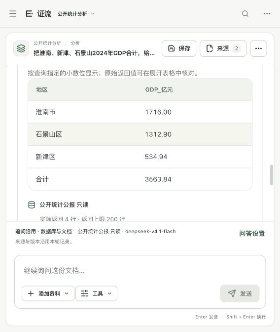
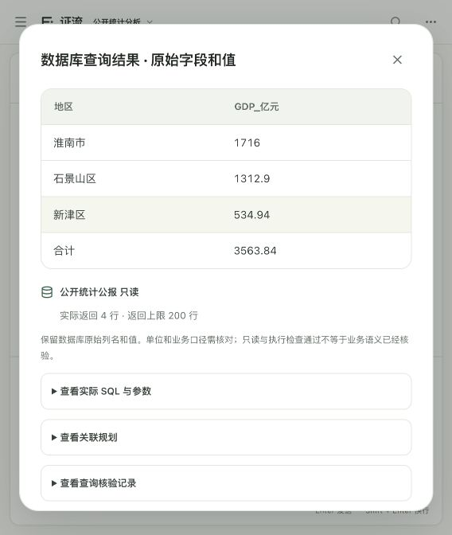

# 跨页口径、引用修复与显示精度核验 · 2026-10-11

本轮修复明确输出列数的漏识别及SQL小数精度展示，并用6个新提问检验DeepSeek的自主查询、跨页引用和统计口径解释。当前完整后端27模块479项、前端61项、类型检查和构建通过；当前目录服务已更新并保留运行。没有按题号写答案、发送参考答案、比较费用、推送GitHub或重建RAR。

## 实现与验证

本轮新增或修改7个代码文件：数据库查询、模型事实传递、前端结果表、3个相关测试文件和迁移评估入口。另将上一段未归档的引用修复代码及评估器摘要补齐记录纳入源码核验，共记录9个不同代码文件。

- 输出合同检查新增“列出……，共N列”，仍在执行前检查最终SELECT，不删掉实际返回列。过去式的“原表列出了……”不当作用户输出指令。
- 仅从实际SQL最终投影的ROUND读取显示精度；UNION等各分支必须一致。展示只补零，不再次四舍五入。文本编号、NULL、未ROUND的列、大Decimal原值和结果摘要保持原样；驱动值与精度不符时保留原值。
- 模型看到原始返回行及显示行，行事实使用指定精度；事实的原值和SQL引用快照仍保留。前端显示相同精度，并提供原始表格入口。
- 通用答案修复反馈提供真实片段编号和完整、有边界的原文证据包，区分span ID与evidence ID；只允许一次修复，不重查来源，不替换未知编号，不放宽无来源数值或语义检查。

证据：[完整后端](验收证据/跨页口径与显示精度完整后端回归-20261011.log)、[前端61项](验收证据/跨页口径与显示精度前端回归-20261011.log)、[类型检查](验收证据/跨页口径与显示精度前端类型检查-20261011.log)、[构建](验收证据/跨页口径与显示精度前端构建-20261011.log)、[源码与部署摘要](验收证据/跨页口径与显示精度源码部署核验-20261011.json)。11个正式构建文件与工作区外构建逐一一致。构建保留现有图表块超过500kB的提示；没有安装工作区内依赖。

初次检查发现“列出了”误当输出指令，以及新测试插入位置错误；均已修正，失败日志保留，最终全量通过。这些工程测试不是479道真实问答。

## 新6题：首测与回归分开保存

问题覆盖三地工业增速排序、外来常住人口占比、GDP价格口径、2023年修订注释、跨页工业占比、两份公报PM10年均浓度比较。题集在首次模型调用前冻结，SHA-256为`a23529863e4f6bf43010f6852b9460057b12d94346dcc563eaeeb3be84ad5c79`；4条参考SQL先在冻结只读库验证。参考与要求不发送模型。

| 运行 | 非空/预期状态 | 技术失败 | 严格SQL | 引用定位 | P95 |
|---|---|---|---|---|---|
| [新6题首测](验收证据/跨页口径迁移DeepSeek首测-20261011.json) | 6/6、6/6 | 0 | 3/4 | 42/42 | 20.13秒 |
| [修复后完整6题回归](验收证据/跨页口径迁移与精度完整回归-20261011.json) | 6/6、6/6 | 0 | 4/4 | 45/45 | 21.74秒 |

首测第5题明确要求3列，实际返回4列，因此严格False；新增“列出”识别后，模型读取错误说明、自主修正SQL，回归返回所需3列。未修改题干、参考或首测分数。

第4题在两次真实执行中都触发一次答案修复：初稿带入了未被该陈述引用支持的其他年份金额，修复后仅保留注释中的2023年修订值与出处。它验证了完整上下文反馈的真实使用；未知片段编号的拒绝与修复仍由协议测试直接覆盖，不能说这两次实际故障就是未知编号。

题集由开发代理基于已知三份公开公报编写，部分题意与既有问题相近；精确重复为0，不代表题意完全独立，也不是独立真人留出或陌生企业库。首测保留为首次接触记录，回归不冒充未见题成绩。4条参考及4条实际SQL另用只读连接重执行，库摘要不变，见[离线SQL核验](验收证据/跨页口径迁移参考与实际SQL核验-20261011.json)。

## 当前浏览器展示

实际只提交一次原GDP合计问题，DeepSeek返回淮南1716.00、石景山1312.90、新津534.94、合计3563.84亿元。正文和主表显示两位小数；展开原始表格后保留原数值，SQL引用快照未修改。实际SQL重新只读执行与保存行一致，见[浏览器核验](验收证据/当前两位小数浏览器核验-20261011.json)。旧参考的横纵布局差异不因此改判。

## 整体目标完成审查

| 原目标 | 当前证据 | 仍未证明的范围 |
|---|---|---|
| 范围、澄清与失败说明 | 当前默认公开项目；自动推荐、范围冻结、澄清、部分回答及明确失败状态；真实新6题非空返回，479项保护边界 | 不能由有限样本保证任何问题或上游永久可用；旧20题的年度澄清参考争议保留 |
| 真实PDF/Word展示 | 三份官方PDF、73条原件绑定观测；本轮跨页及两原件核对；SQL→结论→引用→原件链已有真实浏览器证据 | Word为真实公报内容的忠实转换件，扫描为真实原件摘页；不是另一个独立官方Word来源或新的独立扫描来源 |
| 复杂SQL与跨源忠实度 | 4条本轮严格SQL；旧20题13条参考及12条实际SQL离线复核；引用修复、真实原文位置与数值检查 | 独立真人正确性、答全、口径及直接支持复核仍按用户决定待办；旧20题完整回归分数仍6/13，不拼接针对成功记录 |
| 三个中级任务 | [58表困难任务](中级困难案例核验-20261011.md)已有同名澄清、54表干扰、多表关联/一对多/跨期/去重/空客户反例及前后记录；当前完整工程测试覆盖 | 合成模式和开发者参考不替代陌生企业库与独立真人判定 |
| 响应及过程反馈 | 去除重复检索/查询、上下文整理；[取消与刷新](会话恢复与取消核验-20261011.md)真实证据及状态读取退避；本轮真实延迟保留 | 两批新6题不同版本单次耗时不证明长期提速；持续负载、真实长期断网仍未核验 |

上一段第12/13题针对回归是2/2状态、0技术失败、0/2严格SQL、37/37定位，未实际触发新修复分支；该记录与旧20题完整结果分开。旧20题严格差异已区分多返回原数/来源列、横纵布局、参考遗漏差值列、年份争议和小数展示缺口，原分数未改。

真人复核及Windows实机按用户决定继续待办。原8题、旧20题、新6题各自保留版本，不合成业务准确率；整体目标仍进行中，不能由工程通过、supported或定位率宣称一等奖已就绪。
