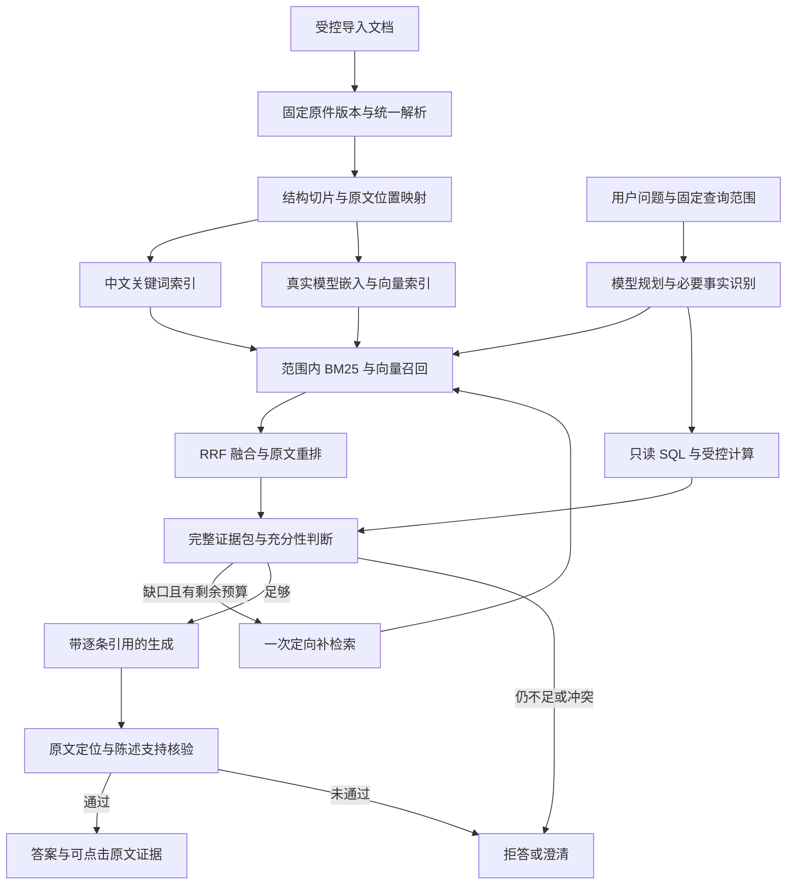

# 证流 RAG 改造设计方案

日期：2026-10-06。状态：研究与设计完成，尚未实施。研究与复核于 2026-10-05 至 2026-10-06 进行。本文依据当前源码、官方赛题 PDF、论文正文及参考项目实际代码整理；本轮只新增设计文档，没有修改程序、调用外部模型、发布 Release 或重新打包。

## 1. 推荐结论与改造目标

推荐采用 **结构切片、BM25 与向量混合召回、交叉编码器重排、证据充分性判断、逐陈述引用生成、生成后支持核验** 的完整主流程，并接入现有智能体、原文定位与任务记录。

这是针对证流的便携运行、中文资料、可解释问数和严格来源约束选择的实施基线。模型、切片长度和候选数量需要用项目中文样本校准，不能从论文或参考仓库推导出未经实测的“全局最优”。

改造完成应具备这些行为：

- 用户用同义表达提问，系统能从原文找到相关事实，并综合回答，而不是只返回字面匹配段落。
- 一个结论需要两个文档时，两份必要证据都进入上下文；每条结论能打开固定版本原件并定位到相应文字。
- 问题需要金额、时期、对象、条件等信息而资料缺项时，系统说明缺什么并拒绝给出确定结论。
- 文档与数据库联合回答时，数据库事实仍来自只读 SQL，计算仍有真实工具记录。
- 召回、重排、模型生成或核验失败时，显示真实失败与降级状态，不把摘录或相近内容显示为成功生成的答案。

推荐首版组合：**SQLite FTS5＋中文预分词、SQLite 向量存储＋NumPy 精确检索、本地 BGE 中文嵌入与本地交叉编码器、现有已配置的生成模型**。不需要 Docker、向量数据库服务器或整体引入大型智能体框架。

## 2. 当前项目的实际缺口

| 当前实现 | 已有能力 | 必须补齐的部分 |
|---|---|---|
| [store.py]([原作者用户目录]/Desktop/证流_赛题八/01_程序代码/backend/store.py:112) | PDF 按页、MD 按标题生成现有 blocks，保存原件版本 | 没有长度约束、句子重叠、表格保护；blocks 的 ID 不代表不可变切片版本 |
| [engine.py]([原作者用户目录]/Desktop/证流_赛题八/01_程序代码/backend/engine.py:139) | 中文二字组、英文词的子串匹配 | 不是 BM25，没有语义向量、融合和重排 |
| [documents.py]([原作者用户目录]/Desktop/证流_赛题八/01_程序代码/backend/documents.py:142) | SHA、parse_id、原页文字、字符范围、bbox、固定版本定位 | 应成为新索引唯一的原文来源；目前索引与定位分别使用 pypdf、PyMuPDF，文字可能不一致 |
| [agent.py]([原作者用户目录]/Desktop/证流_赛题八/01_程序代码/backend/agent.py:484) | 模型可真实调用 document.search，记录工具输入输出、失败和耗时 | 替换检索内部实现，增加证据包、充分性与支持核验 |
| [agent.py 的回答协议]([原作者用户目录]/Desktop/证流_赛题八/01_程序代码/backend/agent.py:580) | 只接受 fact_id 或精确连续原文摘录 | 新增带引用的综合陈述协议；仅增强检索仍无法产生综合答案 |
| [workspace.tsx]([原作者用户目录]/Desktop/证流_赛题八/01_程序代码/frontend/src/workspace.tsx:84) | 逐条结论展示与多来源入口 | 空结论也可能显示完成绿勾；拒答原因需要独立展示 |
| [evaluation.py]([原作者用户目录]/Desktop/证流_赛题八/01_程序代码/backend/evaluation.py:11) | 五个确定性示例的子串检查 | 不能衡量模型 RAG、引用支持或拒答可靠性，需要独立评测集 |

尤其要避免两个局部修补：把旧子串得分改名为 BM25；放宽 quote 校验让模型直接自由回答。前者没有真正改进检索，后者会失去现有证据保护。

## 3. 论文阅读结论与取舍

以下是读取方法、实验与限制后，对本项目的设计判断，不是论文结果在证流上的复现声明。

| 论文 | 对证流有用的结论 | 本方案的取舍 |
|---|---|---|
| [Searching for Best Practices in Retrieval-Augmented Generation，EMNLP 2024](https://aclanthology.org/2024.emnlp-main.981/) | 切片、混合检索、重排和上下文组合应联合比较；改写并非总能提高效果 | 用结构切片和完整流程做消融；不照搬英文实验的固定最优参数 |
| [Reciprocal Rank Fusion，SIGIR 2009](https://doi.org/10.1145/1571941.1572114) | 使用不同检索通道的排名融合，避免直接混加不同量纲分数 | BM25 与 dense 使用 RRF；融合得分不作为答案置信度 |
| [Passage Re-ranking with BERT，2019](https://arxiv.org/abs/1901.04085) | 广召回后，对问题与候选联合编码进行精排 | 使用现成中文交叉编码器；相关性重排不承担事实核验 |
| [BGE M3-Embedding，2024](https://arxiv.org/abs/2402.03216) | 多语言、多粒度和多种检索表示有研究价值 | BGE-M3 作为质量对照；它的学习型 sparse 表示不能直接称为 BM25 |
| [Enabling Large Language Models to Generate Text with Citations／ALCE，EMNLP 2023](https://aclanthology.org/2023.emnlp-main.398/) | 需要评测每条陈述是否被引用支持，以及引用是否必要、相关 | 逐陈述引用和支持核验；NLI／模型裁判仍需人工校验 |
| [Sufficient Context，ICLR 2025](https://arxiv.org/abs/2411.06037) | 检索内容相关，不代表它包含回答所需的全部信息 | 生成前核对必要事实和缺口；采用比论文更严格的“文档事实只依据本轮证据”策略 |
| [Corrective Retrieval Augmented Generation／CRAG，2024](https://arxiv.org/abs/2401.15884) | 检索质量判断可以驱动有限纠正，而不是直接把坏结果交给生成器 | 最多一次补检索后再判断；不默认使用论文的外部网页补充，也不声称复现其训练评估器 |
| [Self-RAG，ICLR 2024](https://arxiv.org/abs/2310.11511) | 检索和生成中的反思、支持检查值得参考 | 借鉴检查步骤；论文涉及训练反思 token，普通提示词自检不是 Self-RAG 复现 |
| [Is Semantic Chunking Worth the Computational Cost?，NAACL Findings 2025](https://aclanthology.org/2025.findings-naacl.114/) | 其测试的语义分段方法没有一致的成本收益优势 | 首版以标题、段落、句子结构分段；仅对必要难例评测语义切片，不能据此否定所有语义方法 |
| [Lost in the Middle，TACL 2024](https://aclanthology.org/2024.tacl-1.9/) | 长上下文中的证据位置可能影响回答表现 | 去重、限制上下文、保留每个必要推理环节，不把全部原文塞给模型 |
| [RAGAs，EACL 2024](https://aclanthology.org/2024.eacl-demo.16/) | 原论文分别评估忠实度、答案相关性和上下文相关性 | 可辅助离线分析；不把自动评测分数当作线上拒答判据或真实性证明 |
| [RAPTOR，ICLR 2024](https://arxiv.org/abs/2401.18059) | 分层摘要有利于长文档的概括检索 | 后续可选导航索引；摘要不能直接替代原文证据，首版不引入摘要树 |
| [ColPali，ICLR 2025](https://arxiv.org/abs/2407.01449) | 页图像检索可以利用版式、表格和图形 | 作为后续视觉召回旁路；热图不证明单元格识别正确，中文与便携 CPU 需单独验证 |
| [OCR Hinders RAG／OHR-Bench，2025](https://arxiv.org/abs/2412.02592) | OCR 的语义错误和格式错误会传导至检索、生成；文字识别指标不能独自代表 RAG 质量 | 扫描页、表格与公式单独验收，必要时比较干净原文与真实 OCR 的整链路差异 |

## 4. 参考项目的可借鉴点与必须纠正的地方

已读取 [knowledge-organism3.0](https://github.com/zdltotdfffs/knowledge-organism3.0) 的主查询、BM25、RRF、重排、改写、覆盖度、向量注册和书籍来源结构。它主要检索派生认知块，目标与证流的精准原文问答不同。

### 借鉴

- [混合召回与融合](https://github.com/zdltotdfffs/knowledge-organism3.0/blob/main/02_引擎/v3_field/query_v3.py#L180)：dense＋BM25＋RRF 的组合可作为基线；首版不引入关系传播。
- [中文 BM25](https://github.com/zdltotdfffs/knowledge-organism3.0/blob/main/02_引擎/v3_field/lexical.py)：借鉴中文分词，索引对象改为标题和完整原文切片，并保护日期、型号、条款号。
- [cross-encoder 重排](https://github.com/zdltotdfffs/knowledge-organism3.0/blob/main/02_引擎/v3_field/reranker.py)：借鉴两阶段检索，输入使用真实原文；候选规模按本机耗时调整。
- [书籍层级与页信息](https://github.com/zdltotdfffs/knowledge-organism3.0/blob/main/02_引擎/挖掘/书籍管道/book_model.py)：借鉴章节、父子关系、页码和待审状态；证流继续绑定 SHA、parse_id、字符位置与 bbox。
- [真实嵌入失败中止注册](https://github.com/zdltotdfffs/knowledge-organism3.0/blob/main/02_引擎/挖掘/书籍挖掘/bridge/safe_register.py#L382)：模型失败不能以假向量或空向量冒充完成。

### 不照搬

- [最终排名](https://github.com/zdltotdfffs/knowledge-organism3.0/blob/main/02_引擎/v3_field/query_v3.py#L307) 强制将 dense top3 放到最终结果前面，使精排不能真正否决这些候选；证流保留原始召回记录，让精排与核验决定使用的证据。
- [覆盖度判断](https://github.com/zdltotdfffs/knowledge-organism3.0/blob/main/02_引擎/v3_field/coverage_gate.py#L81) 主要判断同领域知识，partial 可被认为 knows，裁判只看到短描述；这不能充当精准拒答机制。
- 重排 sigmoid 分数与固定阈值不能当作答案正确概率；模型不可用、超时和正常低相关必须分开记录。
- [问题改写](https://github.com/zdltotdfffs/knowledge-organism3.0/blob/main/02_引擎/v3_field/query_rewriter.py#L19) 的模型分支不保证保留原问题，字符串清理还可能剥掉开头年份；证流必须保留原始检索通道和结构化约束。
- [知识块 evidence](https://github.com/zdltotdfffs/knowledge-organism3.0/blob/main/02_引擎/挖掘/书籍挖掘/schemas/knowledge_artifact.py#L25) 包含挖掘统计，派生块与页码不足以证明某条生成陈述；必须回到可核对原文。
- 首版不采用自动在线向量漂移、查询回流学习和跨域补集。使用次数不等于正确反馈，索引变动必须可追溯、可复现。
- 持续服务需要索引代次与缓存失效；不沿用一次脚本查询式的全局 BM25 缓存。

对先前提供的 [ERP-AGENT-open-source](https://github.com/wodrake/ERP-AGENT-open-source) 另行补读了 README。其“规划、执行、审查、结果”、执行信号升级审查和冻结配对评测适合参考主流程治理。证流已有真实工具机制，RAG 应接入该机制；对于综合事实回答，证据充分性与引用支持属于必需发布检查，不能仿照一般闲聊路由跳过。它的 Docker 沙箱、MongoDB、Java ERP 和写操作审批不属于本次便携只读 RAG 的依赖选择。这部分依据文档说明，未运行或复现该项目。

## 5. 完整架构



检索器不拥有扩大范围、写业务数据库或启用外部服务的权限。模型负责规划与综合，服务端负责范围、事实、来源、预算和最终发布状态。

## 6. 统一解析与合理切片

### 6.1 统一原文来源

新索引全部基于 `documents.layout(document_id, sha, parse_id)`。保留原页 Unicode 文字不变；检索用的空白折叠、大小写、全半角、繁简等归一化结果另存。凡需从归一化结果回到原文，必须有显式偏移映射，不能拿处理后的字符串偏移去高亮原 PDF。

继续保留旧 blocks：现有规则、历史引用和确定性路径仍使用它们。新 RAG 使用新增的不可变切片表，避免改变已有证据 ID 的含义。

目录与标题采用优先顺序：已有书签／MD 标题 → 字体和版式启发式 → 页内段落。缺目录时记录结构识别不完整，不能伪造层级。扩展解析字段时产生新 parse_id，历史解析仍可打开。

### 6.2 子块检索、父级补上下文

下列为首轮实验起点，实际长度使用选定模型的 tokenizer 计量：

| 项目 | 初始设置 | 边界规则 |
|---|---|---|
| 检索子块 | 目标约 384 tokens，常见范围 300–450 | 先按标题、段落、句子分；硬上限要为标题、查询和模型特殊 token 留余量 |
| 相邻重叠 | 目标约 48 tokens | 优先完整句子；不把否定、适用条件拆离主句 |
| 父级上下文 | 上限约 1,200 tokens | 命中后补必要相邻原文；必须裁剪到允许范围和总上下文预算 |
| 表格 | 表名、表头、单位与少量完整行组成一块 | 大表按行组切，重复表头是派生上下文，每个表头及单元格仍映射真实来源 |
| 公式 | 公式、变量定义、单位、适用条件一起保留 | 超长时拆成有关联的原文块；计算依赖单独绑定，不能只检索孤立公式 |

页内连续原文可以保存一个 span；跨页父级、表头＋非连续行等必须保存多个 span。跨页不得制造一个假的连续字符范围。页码、标题路径、原文及派生检索描述分开存储，派生描述不能自动成为引用。

重复页眉页脚降低检索权重，但不删除原件定位文字。解析缺页、阅读顺序不确定、疑似 OCR 错字或表格结构不可靠都进入质量字段，供充分性判断使用。

## 7. 索引、模型与便携部署

### 7.1 存储设计

在应用库 `app.db` 新增 `ef_rag_*` 元数据与切片表；业务库 `business.db` 保持独立。检索以只读连接读取应用库及已发布的关键词索引，索引以受控写连接建立；不能误用当前只读业务查询入口读取 RAG，也不能让 NL2SQL 看到应用内部表。

| 新表／索引 | 主要内容 |
|---|---|
| `ef_rag_generations` | 文档 SHA、parse_id、切片版本、结构／关键词／向量状态、激活代次与构建清单 |
| `ef_rag_chunks` | 不可变 chunk_id、标题路径、类型、原始 span 列表、文字摘要、质量、邻接关系 |
| `ef_rag_lexical_manifests`＋FTS5 产物 | 全库关键词发布代次、包含的切片代次、分词配置、文件摘要及不可变 FTS5 索引 |
| `ef_rag_embeddings` | chunk_id、模型指纹、维度、归一化方式、输入哈希、float32 向量 |
| `ef_rag_index_jobs` | 实际待建／运行／成功／失败／取消状态、处理数、耗时、错误和重试次数 |

切片身份绑定 `document_id + SHA + parse_id + chunker_version + span清单`。嵌入缓存身份还包含模型实际 revision、tokenizer、pooling、维度和完整输入哈希；标题或表头变化也会使缓存失效。向量须检查数量、维度、有限数值及非零范数，严禁混用不同模型空间。

### 7.2 关键词检索

采用真正的 FTS5 BM25。中文先用版本固定的分词器分词，保留型号、日期、金额、条款编号和英文标识；必要的未知词二字组回退与主词通道分开控制。FTS 查询由服务端构建和参数绑定，不能直接执行模型给出的 MATCH 表达式。

关键词统计也必须固定：FTS5 的文档频率与平均长度基于整张 FTS 表，WHERE 过滤切片 ID 不能冻结这些统计。首版采用每个已发布全库清单对应一份不可变 SQLite FTS5 产物，构建完成校验后原子切换清单；暂存构建、历史切片不能混入活动 FTS 表。任务快照保存 `lexical_generation` 和产物摘要，使用该产物的固定 BM25 统计。

FTS5 产物放在既有运行数据位置，例如 `DATA/rag_lexical_<generation>.sqlite`，不建立新的可见阶段目录。新导入／替换／归档触发新发布代次；归档立即在候选过滤中排除，统计更新尚未发布时记录当前使用的统计代次。运行中撤销使用范围会有意改变可用证据并留下记录，不能为了复现继续使用被撤销来源。旧索引产物保留到引用它的待执行／运行任务结束，再按保留策略清理；历史答案继续保留原文证据。若原统计产物已清理，不能声称可完全重放历史检索。

本轮只读探测确认当前便携 Python 的 SQLite 3.50.4 提供 FTS5。其 `bm25()` 返回值按较小者优先，实现不得误按较大者排序。这只证明本机该依赖能力，不证明中文检索质量、Mac 随包能力或 Windows 完整冷启动已通过；其他平台缺 FTS5 时需明确报错或使用真实 BM25 回退。

### 7.3 向量检索

初版把向量保存为 SQLite BLOB，用已有 NumPy 对范围内向量做精确余弦检索。加载后的矩阵按索引清单和模型指纹缓存，文档变更原子替换。范围过滤在 topK 之前执行，不能全库取少量候选后再过滤。

512 维 float32 的 10,000 条向量本身约占 20.5 MB，尚未计模型、文字、缓存和数据库开销。是否需要 HNSW／FAISS 应依据 10／100／500 页及更大库的真实性能分析决定；首版不增加向量服务器。

### 7.4 推荐模型与运行方案

- **默认嵌入候选**：[BAAI/bge-small-zh-v1.5](https://huggingface.co/BAAI/bge-small-zh-v1.5)。中文模型，实际配置为 512 维、512 位置上限；不要套用英文 small 模型的维度。按官方方式使用 CLS pooling、L2 归一化，查询前缀仅加在查询侧。[实际配置](https://huggingface.co/BAAI/bge-small-zh-v1.5/raw/main/config.json)
- **默认便携重排候选**：`BAAI/bge-reranker-base`；质量对照为 `BAAI/bge-reranker-v2-m3`。均需真实处理“问题＋原文”输入。选用 base 是部署成本的初始判断，最终用同一中文评测集比较支持率、召回损失、CPU 耗时和内存；不把 v2-m3 大模型直接设为所有机器默认。[官方模型说明](https://huggingface.co/BAAI/bge-reranker-v2-m3)
- **运行方式**：优先评估 ONNX Runtime CPU＋固定 tokenizer，避免把整套训练依赖塞进便携包。官方提供 Python 运行接口，但具体模型导出、当前 Python 3.13、Windows／Mac wheel、量化误差和冷启动仍需第一阶段实测。[ONNX Runtime 文档](https://onnxruntime.ai/docs/get-started/with-python.html)
- 模型导出与量化在构建环境完成；运行时只加载审定的模型文件。固定来源、revision、SHA 和许可证，用户显式安装模型包后才启用，不在程序启动时自动下载大模型。
- 现有生成模型继续负责规划、充分性、综合生成和支持核验。使用同一个模型的分开评审调用属于模型检查，不能包装为独立、确定性的事实证明。

必须新增明确的 embedding／rerank provider 类型与就绪测试。聊天连接支持 chat 不代表支持 embeddings 或 rerank。每种连接分别验证响应、模型、维度或候选分数，并沿用现有加密保存、revision、隐私、超时和取消机制。

默认本地建索引。远程 embedding 会批量发送文档切片，范围大于普通问答上下文；提供远程选项时，需展示服务目标、文档、切片数量和发送量，由用户主动启动。已有聊天连接配置不能自动视作整库外发许可。

## 8. 索引生命周期与查询范围

### 索引生命周期

1. 导入原件和版本提交成功，再创建后台解析／索引任务；禁止在现有写事务中嵌套 `documents.layout`、长时间解析或模型调用。
2. 新代次构建完整的切片与关键词索引后可发布“关键词就绪”；向量完整且校验通过后再标记“混合检索就绪”。失败页和未完成向量不得隐藏。
3. 文档替换、页面重读、切片器或模型变更产生新代次。新代次未就绪时显示待建或降级；旧版本向量不能冒充新版本索引。
4. 归档立即排除新问答召回，恢复时检查对应代次。历史结果保留原件版本、解析与来源，不能自动换成新文件。
5. 中断任务重启后标记中断并有界重试；完成状态以真实写入和校验为准。

### 范围冻结

服务端使用 `selection | page | document | corpus` 明确范围，冻结文档 ID、SHA、parse_id、可用切片／向量代次及 `lexical_generation` 清单。现有“这段／本页”提问仍严格限制对应选区或页面；父级上下文扩展也不能越界。全文与跨文档问答通过明确入口选择。

排队前准备解析和检索清单，避免在当前任务写事务内另开解析写连接；提交事务中核对 revision 后冻结。执行中再次检查归档、连接启用与隐私变化等撤销条件。文档普通更新不让已排队任务悄悄换版本，历史版本范围继续可核对。

同步修复模型路径的文档范围持久化：显式文档范围写入 `result.query_spec.document_context`，追问继承父任务的服务端范围；不能仅修确定性 engine 路径。当前会话 workspace 还不是多租户文档权限体系，首版不宣称已实现用户间知识库隔离。

## 9. 召回、融合与候选重排

默认参数作为可校准配置保存，写入每次运行快照：

1. 保存原问题；规划输出必要对象、时期、指标、条件和子问题。歧义影响答案时先澄清。
2. 在冻结范围内，原问题 BM25 top30、向量 top30 并行召回；相同切片按不可变 ID 合并。
3. 用 RRF 融合，初始 `k=60`：`score(chunk)=Σ 1/(k+rank)`。不同通道的原分数和排名保留，不直接混加。
4. 对融合前 30 个候选最多进行一轮真实 cross-encoder 重排。便携机器可以调到 20；记录实际候选数。查询和原文超 token 上限时有界分窗并记录，不静默截掉适用条件。
5. 合并重叠原文，保留各必要子问题、时期及冲突证据。相似候选去重不能删掉多跳问题需要的第二份文档，也不强制把任何 dense top3 塞入答案。
6. 形成最多 6–8 个证据单元，必要时补相邻原文；总包初始约 4,000 生成模型 tokens，同时受现有字符限额约束。发送完整、可定位单元，替代每份机械截取前 2,000 字。
7. 充分性判断发现可补的缺口时，最多一次定向补检索，可带最多两个子查询。保留原问题及对象／日期／编号约束，不用改写文本替代原问题。

精确编号命中可以作为单独可记录的排序特征；不能拿年份文件名当政策有效期。有效期必须来自明确原文或受控元数据。首版不默认生成 HyDE 假答案，不训练新检索器，不建立自动关系扩散图。

`document.search` 保留现有工具入口，内部阶段接入真实 trace；可新增有界 `document.read`、`evidence.assess`、`answer.verify`。所有阶段共用取消与总预算，不通过内部调用绕过限制。

## 10. 基于证据生成与拒答

### 10.1 证据包

每个证据单元由服务端提供：`evidence_id`、`support_span_id`、完整原文、文档版本、页码、字符范围、摘要校验值、质量与必要的来源关系。模型只能引用这些 ID，不能自造页码、文件路径或定位器。用于检索的标题拼接和表格描述明确标注为派生信息。

### 10.2 生成前的充分性判断

输出问题需要的事实清单及对应证据，标记缺失、冲突和解析限制，状态为 `sufficient | insufficient | conflicted | unknown`。

例如问“2025 年甲产品售后赔付上限和例外条件”：只找到 2024 年乙产品的相关条款，应判不足；只有赔付上限、没有例外条件，也不能完整回答。相似度高、同领域、来源数量多都不能自动说明足够。

不足且可补时进行一次补检索；仍缺必要事实则拒答并显示缺项。问题包含多个独立子问时可发布有证据的部分，并显式标出未回答部分；某个核心结论缺一跳时不能以 partial 掩盖完整结论无依据。

资料相互冲突且无明确适用期或对象可消解时，展示冲突并请求澄清，或拒绝统一结论。上传时间最新不代表规则有效。检索没命中只能说明当前证据不足，不能推断文档绝无该事实。

### 10.3 扩展答案协议

保留现有 `fact_id` 和精确摘录；新增 `kind=synthesis`：

```json
{
  "claims": [
    {
      "kind": "synthesis",
      "text": "可单独核对的一条结论",
      "support_span_ids": ["服务端本轮提供的引用位置 ID"]
    }
  ],
  "missing_requirements": []
}
```

模型草稿不决定最终 verified 或 answer_status。每条结论尽量是一项事实，最多沿用当前 12 条；实体、时间、否定、适用条件、单位、比较和因果都需要对应证据。

### 10.4 两层核验

**确定性定位检查**：引用属于本轮实际送入模型的证据，处于冻结范围内；固定 SHA 与 parse_id 可重定位，文字摘要一致，原件未篡改。不能引用后台召回过但没有交给模型的候选。

**语义支持检查**：检查器收到原问题、冻结的对象／时期／条件及必要事实清单；对每条结论，只以其引用原文作为事实依据，判断 `supported | unsupported | contradicted | unknown`，说明缺条件或冲突。这样才能避免旧年份或其他对象的原文支持一条省略对象的泛化句。复合句分解检查，多段联合支持时保留完整依据。判断失败或 unknown 阻止发布该综合结论；同一模型的自检仍可能出错，最终质量通过人工评测验证。

最多 12 条陈述采用批量核验调用，逐条返回状态，不能为每条另加一次模型请求导致突破总预算。核验与修订请求有界，仍计入共享模型次数；预算不足时不能省略发布检查。

**最终覆盖检查**：核验后重新检查保留结论是否覆盖问题的全部必要事实。生成漏答或删去关键陈述后，不能沿用生成前的 sufficient。服务端结合支持结果、覆盖缺口和独立子问题决定最终 `supported／partial／refused／needs_clarification`；模型草稿中的 `missing_requirements` 只是建议，最终缺项清单由服务端核对收口。

来源定位通过、模型支持检查通过、答案是否充分分别展示；现有 coverage 只是绑定来源比例，现有 verify_claim 也不是通用语义蕴含，不能改名为“真实性 100%”。

### 10.5 数字与文档／SQL 联合回答

数据库事实继续使用服务端 `fact_id`、只读 SQL、查询快照与 query_id 防混用。文档直接数值绑定具体原文及单位；派生结果必须调用现有 Decimal 计算工具，并扩展其参数登记，使文档数值也有不可变来源。生成文字不能自行完成无记录的金额计算。

联合问题按“SQL 得到事实 → 文档找到规则／公式与条件 → 工具计算 → 核验 → 带引用回答”执行。首版保持一份 SQL 快照，复杂数据优先在 JOIN／CTE 中完成，不放宽不同 query_id 混用保护。资料仅同时出现某现象和某措施，不能据此生成确定因果结论。

### 10.6 失败处理

| 情况 | 必须表现出的行为 |
|---|---|
| 向量失败、关键词正常 | 记录向量错误与“仅关键词检索”；仍需充分性和支持检查 |
| 重排失败 | 使用已取得的融合顺序，明确未完成重排，不制造重排分数 |
| 扫描页无文字、索引缺页 | 区分待 OCR、解析失败与缺资料，拒绝凭空补出结论 |
| 生成失败 | 可以显示相关原文供查看，但显示本轮未生成答案 |
| 充分性／支持评审超时或 JSON 无效 | 不发布未经检查的综合答案；可保留明确标注的原文摘录 |
| 来源归档 | 排除新召回；原件仍在且允许读取时，历史引用可复查并标“已归档” |
| 原件缺失／损坏／篡改或实际读取权限撤销 | 阻止使用；历史结果显示具体不可复查原因，不能自动替换新版 |
| 预算耗尽／取消 | 记录实际状态，不追加无限重试，不展示晚到结果 |

文档内容作为不可信资料输入，不能改变系统指令、SQL 只读策略、工具权限或外发配置。引用链接由服务端构建，原文按现有界面安全渲染。

## 11. 智能体、可观察记录与界面

### 主流程与预算

在现有 sales／database 基础上增加 knowledge／hybrid 路径，复用已有模型规划和工具记录。生成前充分性、生成后支持检查也是实际模型调用，计入现有 **最多 8 次工具、12 次模型、180 秒** 总限制。

嵌入、重排的内部批量请求另设有限请求数、候选数和 token 上限，并纳入总截止时间、取消和并发控制。不能因它们不是聊天模型就无限请求。每次外部调用重新核对连接 readiness、revision、隐私；取消不承诺已发出的远程计算一定被终止。

本地模型按指纹共享加载，设置独立推理并发与线程预算，避免四个任务各加载一份大模型、再叠加运行库线程。后台索引初始单任务执行，问答与索引共享有界推理资源；取消后不发布晚到结果。本地推理的可中断粒度通过原型实测说明。

### 真实 trace

记录解析／索引代次、召回通道、通道排名、融合排名、重排实际模型与输入窗口、使用的来源 ID、缓存命中、缺口、失败原因、调用耗时和发送量。输出按预算截断，只保存有限候选与必要说明；不记录密钥、整库正文或私有文件绝对路径。

面向用户展示“查了什么、依据在哪里、缺什么、为何降级”。不展示模型隐藏思维，也不将反思文字伪装为可验证事实。

### 前端

- 知识目录分开显示“原件解析”和“检索索引”状态；索引显示待建／建中／关键词就绪／混合就绪／降级／失败、实际数量与版本。
- 问答结果新增 `answer_status=supported | partial | refused | needs_clarification`，与任务 completed／failed／cancelled 分开。正常拒答是任务结束，但不是成功生成结论。
- 拒答原因、缺失信息、冲突证据和可查看原文独立呈现；不能以 0／0 来源显示“全部有依据”。
- 逐条结论支持多个引用；点击后沿用固定版本页码、原文高亮和定位检查。语义支持检查另列其模型与状态。
- 未配置生成模型时标注“原文检索”；向量／重排未就绪显示实际可用能力。
- 文档提问保留本页／选区，并新增明确全文／跨文档范围入口；设置页面说明远程批量索引的真实外发范围。
- 宠物状态继续来自真实任务和事件，拒答完成后结束查找状态。

## 12. 扫描件、表格和公式的衔接

文本 RAG 主路先完成，但总体设计必须给多模态原文留下入口：

1. 页级质量评估记录方向、模糊、可提取文字、阅读顺序和疑似识别错误，决定文本解析或 OCR，不给所有文档强制 OCR。
2. OCR 结果形成新的不可变 parse_id，保存原图、模型版本、识别文字、区域 bbox 与质量。对金额、日期、单位和公式符号设置难例核验；文字置信分数不能直接变成答案正确率。
3. PDF 表格与公式先保存可复查来源关系；识别不确定时拒绝计算，不把平铺文本自动当作正确单元格关系。
4. ColPali 可作为未来页图像召回通道，命中页仍回到 OCR／表格／图表读取和统一原文证据体系。其原始多向量索引约 256 KB／页、速度在 GPU 环境测得，不能用作便携 CPU 的性能承诺。[论文正文与限制](https://arxiv.org/html/2407.01449v3)

首版不引入重型视觉检索模型、RAPTOR 摘要树或 GraphRAG；等文本主路和 OCR 真实误差评测完成，再按失败样例决定是否增加。这些属于后续可选项，不自动进入本轮实施范围。

## 13. 具体修改清单

新模块放在既有 backend 目录，不新增阶段目录。

| 模块 | 修改内容 |
|---|---|
| 新 `rag_index.py` | 切片、来源映射、索引表迁移、不可变关键词产物、构建任务、代次发布和失效 |
| 新 `rag_retrieval.py` | 固定范围过滤、BM25／向量召回、RRF、去重、重排和上下文组装 |
| 新 `rag_providers.py` | 本地模型加载、embedding／rerank 接口、能力测试、预算和取消 |
| 新 `rag_grounding.py` | 证据包、必要事实映射、充分性、综合陈述校验和支持审查 |
| [documents.py]([原作者用户目录]/Desktop/证流_赛题八/01_程序代码/backend/documents.py) | 统一解析、可选结构字段、多 span／OCR 来源关系；保留历史解析和 resolve 保护 |
| [store.py]([原作者用户目录]/Desktop/证流_赛题八/01_程序代码/backend/store.py) | 新增应用表与受控读写入口，不覆盖旧 blocks 或业务只读保护 |
| [main.py]([原作者用户目录]/Desktop/证流_赛题八/01_程序代码/backend/main.py) | 索引生命周期、明确范围、状态接口及受控重建入口 |
| [connections.py]([原作者用户目录]/Desktop/证流_赛题八/01_程序代码/backend/connections.py) | 新 provider 类型、测试、隐私／revision 检查和真实能力显示 |
| [agent.py]([原作者用户目录]/Desktop/证流_赛题八/01_程序代码/backend/agent.py) | 主流程接线、synthesis 协议、工具预算、真实 trace、事实计算保护 |
| [conversations.py]([原作者用户目录]/Desktop/证流_赛题八/01_程序代码/backend/conversations.py) | 冻结范围与索引清单、模型追问恢复、结果状态持久化 |
| [workspace.tsx]([原作者用户目录]/Desktop/证流_赛题八/01_程序代码/frontend/src/workspace.tsx)、[evidence.tsx]([原作者用户目录]/Desktop/证流_赛题八/01_程序代码/frontend/src/evidence.tsx) | 综合陈述、拒答／部分回答、引用定位与语义检查分开显示 |
| [catalog.tsx]([原作者用户目录]/Desktop/证流_赛题八/01_程序代码/frontend/src/catalog.tsx)、[agent.tsx]([原作者用户目录]/Desktop/证流_赛题八/01_程序代码/frontend/src/agent.tsx)、[settings.tsx]([原作者用户目录]/Desktop/证流_赛题八/01_程序代码/frontend/src/settings.tsx) | 索引真实状态、知识库范围、调用轨迹、本地模型和批量外发说明 |
| [evaluation.py]([原作者用户目录]/Desktop/证流_赛题八/01_程序代码/backend/evaluation.py) 与现有 tests | 保留现有回归，增加冻结 RAG 评测入口、报告及协议／故障／范围测试 |

## 14. 验收与如何选出实际最优配置

### 14.1 冻结中文评测集

建议至少 20 份经过许可的示例文档，包含 PDF／MD／TXT、表格、公式及扫描难例；标注问题、最小必要原文 span、正确答案或拒答原因。不得把用户私人上传文件放入公开交接包。

正式质量集建议 160 题：80 个单文档事实／条件题、20 个跨文档必要多跳题、20 个 SQL＋文档题、20 个资料不足题、10 个资料冲突题、10 个歧义澄清题。扫描、表格、公式作为这些题的附加标签，分别报告成绩。另设开发集用于调参，按文档族与版本隔离；正式测试集不用来选择阈值。

标注需检查跨文档题是否确实需要两份资料，防止形式上有两个引用、实际一段就能回答。机器辅助出题后仍由人核对必要证据与无答案标签。

跨源题至少覆盖五种可展示类型：数据库事实＋文档规则、数据库指标＋文档定义、数据库数值＋文档公式、两文档实体关系、多文档有效期／例外条件。各题标注必要来源组合，检索命中按关键事实与条件的完整覆盖计算，不以任意字符相交算找到证据。

### 14.2 消融比较

| 版本 | 比较目的 |
|---|---|
| 当前二字组＋摘录 | 保存真实原始基线 |
| 结构切片＋BM25＋生成 | 验证切片、关键词与生成的贡献 |
| 结构切片＋dense＋生成 | 验证同义表达和语义召回 |
| 混合召回＋生成 | 验证两通道互补 |
| 混合召回＋重排＋生成 | 验证精排收益与实际成本 |
| 完整充分性＋逐陈述核验 | 验证无依据作答下降与可回答误拒的变化 |
| 有限改写／真实 OCR 等可选项 | 只在对应难例上证明增益，避免无必要增加调用 |

检索消融使用同一生成模型、token 预算和评测集；嵌入／重排模型比较也固定其他条件。摘录基线与生成答案同时分别报告任务正确性，不能只比较答案长度或流畅性。

### 14.3 指标

- 检索：必要证据 Recall@30、完整证据组命中率、重排 nDCG@10、最终上下文覆盖率。
- 答案：人工正确率、逐陈述支持率、必要引用完整率、引用定位成功率、错误数值／单位／条件率。
- 拒答：资料不足题错误作答率、可回答题误拒率、冲突识别与澄清正确率；同时报告答案覆盖率，防止“全部拒答”取得虚假高忠实度。
- 性能：10／100／500 页，冷／热启动，索引耗时、P50／P95、吞吐、内存和索引大小。按实际硬件和已配置模型，分别测并发 1／2／4，记录队列等待、失败、取消和降级。
- 安全回归：SQL 只读、不同 query_id 防混用、假引用、越界、错误 SHA／parse、原件篡改、运行中隐私撤销、密钥与个人运行数据不入交接。

建议内部发布门槛：受控测试的引用定位与范围校验 100% 通过；必要证据 Recall@30 争取 ≥95%；人工陈述支持率争取 ≥95%；资料不足题错误作答率 ≤5%；可回答题误拒率 ≤10%。这些是拟定验收目标，不是已达结果，也不替代赛题评分口径。性能门槛在实际本地模型原型测量后确定，不提前承诺 CPU 秒数。

协议夹具和模拟响应只能验证链路，不证明中文模型质量、OCR 或外部数据库可用。报告明确区分静态检查、协议测试、真实模型评测与 Windows／Mac 实机冷启动。

## 15. 实施顺序与完成条件

| 阶段 | 工作 | 进入下一阶段前的证据 |
|---|---|---|
| A：来源与运行原型 | 固定范围、统一解析、不可变切片；在便携运行环境验证真实 embedding／rerank 的 tokenizer、导出和结果 | 字符定位回归通过；真实模型可加载，输入／输出与维度检查通过；记录 CPU 耗时与内存 |
| B：可用的混合检索 | 索引任务、FTS5、向量、RRF、真实重排、完整证据包、导入／重读／归档失效 | 同义表达和编号用例通过；版本／范围不串；故障真实降级；召回消融报告 |
| C：完整生成与拒答 | 主模型综合协议、充分性、支持核验、追问范围、结果与界面状态 | 跨文档回答有逐条依据；缺证据／冲突／评审失败均不发布无依据结论；模型链路与 UI 回归 |
| D：比赛验证与交付 | SQL＋文档计算、多格式与 OCR 难例、10／100／500 页性能、依赖与许可、源码与 RAR | 人工冻结集、实机状态与失败数据如实记录；交接排除运行索引／上传／会话／密钥 |

完整文本 RAG 至少做到 C，不能把只完成向量召回称作“RAG 已完成”。D 中 OCR、外部模型与数据库按实际验证结果交付；未通过项目明确列为待验证，不用协议测试代替。

完成本轮后续实施与交付时更新现有三个说明文件，按工程约定交付整理源码和 RAR 后暂停。本文没有启动上述实施，也没有改变当前 Release。

## 16. 官方要求对应

依据本地 [赛题八官方 PDF](<[原作者用户目录]/Desktop/证流_赛题八/05_比赛与交接/官方资料/8 赛题八：网信产业应用赛道-多模态数据驱动的可解释精准问数问答智能体（中电云计算技术有限公司）.pdf>)：

| 官方内容所在页 | 本方案对应 |
|---|---|
| 第 4 页：单文档 RAG 与来源展示基础能力 | 完整检索、综合生成、逐条引用与原文高亮 |
| 第 5–6 页：实体、语义澄清、公式、目录结构、解析与质量任务 | 问题事实约束、结构切片、公式条件绑定、页级质量与 OCR 路由；整体问数关联仍复用现有 SQL 能力 |
| 第 9 页：解析／切片／向量／生成融合、结构化与文档协同、示例资料与技术说明 | 新模块、SQL＋文档路径、真实 trace、至少 20 份拟定评测资料与依赖说明 |
| 第 10 页：RAG 测试、忠实度、规模效率和多轮对话 | 冻结人工集、引用支持与拒答、多规模性能、模型路径追问范围测试 |
| 第 12–13 页：跨源、多跳、多文档／多模态与 10／100／500 页测评 | 必要证据组、多格式／OCR 难例、计算来源、三档性能与硬件／失败报告 |

这里对应的是阅读到的官方材料，不是对比赛全部要求已完成的声明；正式参赛还需按组织方更新后的材料核对最终口径。
