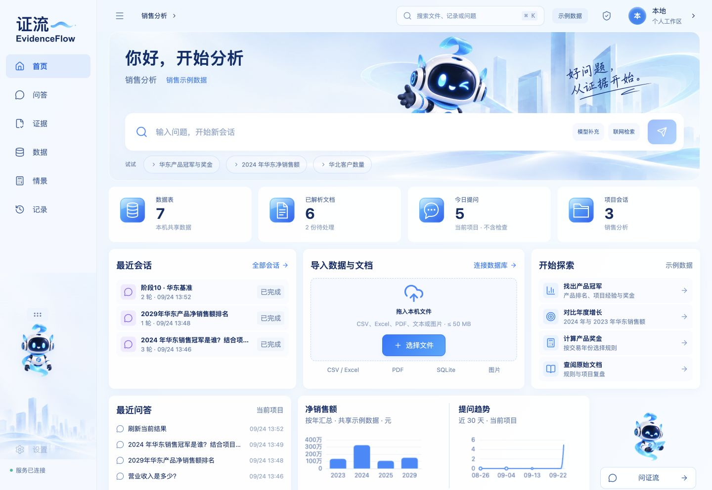

# EvidenceFlow 证流 · 动态首页与冰蓝 UI 新版

**版本：2026.09.26 UI｜主分支：`main`｜发布标签：`ui-2026-09-26`**

当前 `main` 为最新的界面与交互版本，包含动态首页、统一冰蓝银灰配色、收藏工具与输入体验优化。

[下载最新版](https://github.com/phoenix-chenli/China-Electronics-Cup/releases/tag/ui-2026-09-26) · [查看源码](https://github.com/phoenix-chenli/China-Electronics-Cup/tree/main)

## 本版变化

- 导航、顶部与内容区统一为浅银灰、冰蓝和珠光白；深色模式使用协调的深蓝层次。
- 首页玻璃雕塑持续悬浮、轨道流光与轻微视差；支持暂停、记住选择、系统减少动态效果，并在离屏或后台停止。
- 输入聚焦时暂停背景运动；长草稿随宽度与字号自动适配，保留中文输入法和 Shift + Enter 换行。
- 次要操作收进菜单，最多固定 3 项常用工具。结论、数据、来源按阅读顺序组织。
- 保留真实查询、条件修改与撤销、来源定位、保存恢复和情景推演。

## 下载与运行

在上方 Release 下载 **`EvidenceFlow-2026-09-26-iceblue-motion.rar`**，解压后使用根目录启动脚本。

- Windows：`启动证流_Windows.bat`，包含 Windows x64 运行环境。
- macOS：`启动证流_Mac.command`，首次环境准备见 [使用说明](使用说明.md)。
- 服务仅监听 `127.0.0.1:8765`，不使用 Docker 或虚拟机。

## 验证与边界

本版 TypeScript、正式构建及 6 项 Node 宠物状态／输入法测试通过；Mac 浏览器检查覆盖 6 种宽度、真实示例查询、动效控制、深色和大字号。新示例查询返回净销售额 780,000 元、3 笔订单、奖金 0 元与 3 个来源。

本轮未重跑全部历史业务测试；**Windows 尚未实机运行**，外部模型、OCR 与外部数据库仍待实际配置和验证。详细范围见 [界面交互验收](03_测试验收/验收证据/界面交互验收.json)。

源码使用交接包中的脱敏快照；不含个人运行数据库、上传、会话或连接密钥。便携包通过实际解压及全部文件 SHA-256 比对，摘要见 Release 的 `SHA256SUMS.txt`。

[使用说明](使用说明.md) · [开发说明](05_比赛与交接/开发说明.md) · [接续清单](05_比赛与交接/待办与优化.md) · [设计与素材说明](04_设计素材/设计与素材说明.md)
