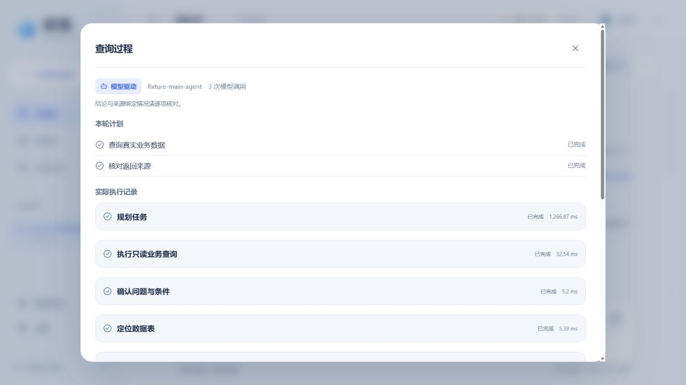

# EvidenceFlow 证流 · 模型驱动主问答

**版本：2026.10.04｜主分支：main**

模型参与主问答的规划、工具选择和答案组织：查看表结构、只读业务查询、文档检索、有来源的计算、核验与回答。每轮保留真实调用、失败、耗时和用量，支持追问、条件重算及取消。既有动态首页、冰蓝银灰界面、来源定位、保存恢复和情景推演继续保留。

## 使用模型主问答

进入“设置 → 模型连接”，添加文本模型、测试并启用；在“主问答方式”选择“指定模型驱动”、选中连接并保存。旧配置默认本地处理，临时问答继续本机处理；远程连接受“仅本机处理”限制。模型收到当前问题、结构化条件和相关证据，不发送整库、完整历史或凭据。

分析页显示本轮方式与调用次数，“查看执行过程”可展开计划、工具输入/返回、失败及耗时。指定模型失败会明确报错。答案仅选择本轮工具事实或可定位原文，证据缺口不会标为核验通过。

## 运行与开发

- Windows：启动证流_Windows.bat，包含 Windows x64 运行环境。
- macOS：启动证流_Mac.command，首次环境准备见 [使用说明](使用说明.md)。
- 服务仅监听 127.0.0.1:8765，不使用 Docker 或虚拟机。

本次源码已更新，干净 RAR 的名称、摘要及解压核验见 [交接包校验](05_比赛与交接/文件清单与许可证/交接包校验.json)。[上一版 UI 发布包](https://github.com/phoenix-chenli/China-Electronics-Cup/releases/tag/ui-2026-09-26) 属于 2026.09.26 版本，不包含本次智能体改动。

## 验证与边界

121 项独立 Python 隔离回归、6 项 Node 交互测试、TypeScript 和正式构建通过，浏览器完成本机模拟模型的问答与设置操作。当前工具限于销售示例口径及关键词原文检索，尚不支持通用新库 SQL、向量检索或 OCR；来源绑定检查不代表业务准确率。

真实外部模型效果、完整 Windows BAT 首次启动、全新依赖缓存、DPAPI 和移动目录仍待验证。源码与交接包不包含个人运行数据库、上传、会话或连接密钥。

[当前进度](05_比赛与交接/当前进度.md) · [开发说明](05_比赛与交接/开发说明.md) · [接续清单](05_比赛与交接/待办与优化.md) · [本轮验收](03_测试验收/验收证据/智能体主流程验收.json) · [设计与素材说明](04_设计素材/设计与素材说明.md)