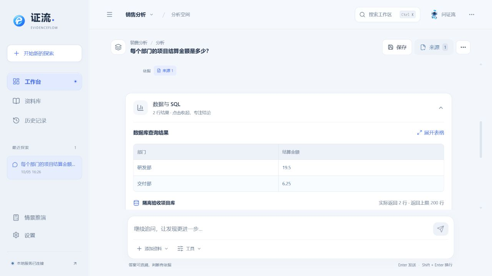

# EvidenceFlow 证流 · 通用自然语言问数

**版本：0.5.0（2026.10.05）｜主分支：main**

模型先读取所选数据库的表、字段、主键、唯一键和关联信息，再规划并生成只读 SQL。支持沿服务端声明或验证的关联路径执行 JOIN、聚合、CTE 和嵌套查询，失败后最多进行 3 次 SQL 尝试。结果保留实际列名、数值、SQL、参数、数据来源、关联路径和校验记录；每轮模型及工具调用的失败、耗时和用量继续持久化。

## 使用数据库问数

进入“设置 → 模型连接”，添加文本模型、测试并启用。在“主问答方式”将“问数范围”设为“数据库问数”，选择“本机工作库（含已导入表）”或已测试、启用的 SQLite / PostgreSQL / MySQL 连接，再选择模型并保存。导入 CSV、XLSX 或数据库表后，可直接询问其中的业务数据；SQLite 和数据库表导入会保留可用的键及关系元数据。

新建问答使用已保存的数据来源，数据库追问沿用原来源。“数据与 SQL”展示查询及真实返回行，来源面板可核对对应 SQL 快照；“查看执行过程”展示模型计划、工具输入、返回与失败。字段或关联语义不明确时可请求澄清。查询结果最多展示 200 行，截断会明确提示；需要全量统计时应让模型用 SQL 聚合。

“销售示例”保留原有确定性查询、文档检索、条件重算和奖金情景功能。旧配置默认本地处理，临时问答继续本机处理。远程模型和数据库受“仅本机处理”限制；模型收到当前问题、所选库结构和有限相关证据，不接收整库、完整历史、路径或凭据。

## 运行与开发

- Windows：启动证流_Windows.bat，包含 Windows x64 运行环境。
- macOS：启动证流_Mac.command，首次环境准备见 [使用说明](使用说明.md)。
- 服务仅监听 127.0.0.1:8765，不使用 Docker 或虚拟机。

本轮干净 RAR、摘要及验收记录见 [通用问数 Release](https://github.com/phoenix-chenli/China-Electronics-Cup/releases/tag/nl2sql-2026-10-05)。本地包的名称、摘要及实际解压核验见 [交接包校验](05_比赛与交接/文件清单与许可证/交接包校验.json)。

## 验证与边界

186 项独立 Python 隔离回归、11 项 Node 测试、TypeScript 和正式构建通过。浏览器使用本机 HTTP 模拟模型与隔离 SQLite 新业务库，完成结构读取、两条外键关联、聚合结果展示、来源查看及配置保存，控制台没有错误或警告。SQL 经结构解析、表字段和作用域检查、可信关联路径检查后，再由只读数据库连接执行；每次数据库操作有 5 秒预算并支持取消等待。来源绑定与 SQL 执行成功不能换算为自然语言问数准确率。

真实模型在独立新库测试集上的准确率、实际 PostgreSQL / MySQL、OCR 和向量检索仍待验证或补齐。完整 Windows BAT 首次启动、全新电脑依赖缓存、DPAPI 和移动目录仍待验收。源码与交接包不包含个人运行数据库、上传、会话或连接密钥。

[当前进度](05_比赛与交接/当前进度.md) · [开发说明](05_比赛与交接/开发说明.md) · [接续清单](05_比赛与交接/待办与优化.md) · [本轮验收](03_测试验收/验收证据/通用问数验收.json) · [设计与素材说明](04_设计素材/设计与素材说明.md)
